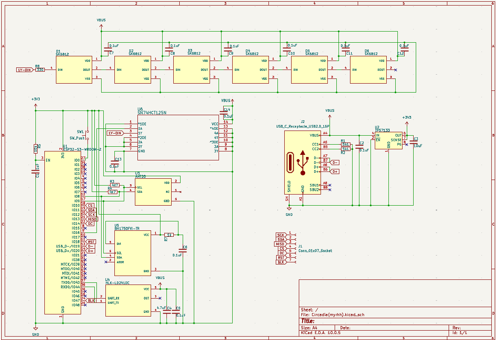

# Circadia
> Third Space Hack Club Week 4!

**Circadia**, an environmental and human presence monitoring smart device, it turns on when it detects the presence of someone and the light vibe is based on the surrounding atmosphere.

## 💠 Project Overview 💠
This weeks project theme is "Autumn", and so we thought, "Hmm, what hardware things can we make with this theme?" and then someone said autumn reminds him of halloween so we thought of a pumpkin emitting light, or some sort of nightlight or something. Anyways, Circadia. It can feel if there's people then it will turn on and shine light, then can change colour too.  
<i>*Note from other guy (guy2): It can also do some astronomical math to calculate sun position and change the light to match it.  
<b>+</b>Monitors dry indoor air.  
<b>+</b>The light scales off the light from the environment!!</i>

### Key Features 🗝️
<ul style="margin-top: -10px; margin-bottom: 0; padding-left: 30px">
    <li style="margin-bottom: 5px">
        <b>Calculates Solar Ephemeris</b>
        <ul style="padding-left: 45px">
            
Fancy way of saying position on the sun.

        </ul>
    </li>
    <li style="margin-bottom: 5px">
        <b>Vapor Pressure Deficit Monitoring</b>
        <ul style="padding-left: 45px">
            
Humidity monitor. 🙏

        </ul>
    </li>
    <li style="margin-bottom: 5px">
        <b>Fractional Brownian Motion for Ambient Light</b>
        <ul style="padding-left: 45px">
            
Random light patterns uses Perlin noise.

        </ul>
    </li>
    <li style="margin-bottom: 5px">
        <b>Light Sensor</b>
        <ul style="padding-left: 45px">
            
This the thing to make the light brighter or dimmer depending on surroundings.

        </ul>
    </li>
    <li style="margin-bottom: 5px">
        <b>Motion Sensor</b>
        <ul style="padding-left: 45px">
            
Detects stuff to auto on and off.

        </ul>
    </li>
    <li style="margin-bottom: 5px">
        <b>LCD Display</b>
        <ul style="padding-left: 45px">
            
Cool display firmware that guy2 did.

        </ul>
    </li>
    <li style="margin-bottom: 5px">
        <b>Halloween Festive Feel</b>
        <ul style="padding-left: 45px">
            
Can feel halloween-y with this thing in living room.

        </ul>
    </li>
</ul>

## Photos
<table>
  <tr>
    <td align="center">
       
      Schematic
    </td>
  </tr>
  <tr>
    <td align="center">
        
      PCB Trace Routing
    </td>
    <td align="center">
       
      3D PCB Render
    </td>
  </tr>
</table>

## BOM
| Reference                             | Qty | Value                       | Exclude from Board | Footprint                                                  | Package                | Price        | Check_prices                                                                                          |
| ------------------------------------- | --- | --------------------------- | ------------------ | ---------------------------------------------------------- | ---------------------- | ------------ | ----------------------------------------------------------------------------------------------------- |
| C1                                    | 1   | 1uF                         |                    | Capacitor_SMD:C_0402_1005Metric                            | Cut Tape (1 Unit)      | $0.02        | https://www.google.com/search?q=https://www.aliexpress.com/w/wholesale-1uf-0402-capacitor.html        |
| C2,C5,C6,C7,C8,C9,C10,C11,C12,C13,C14 | 11  | 0.1uF                       |                    | Capacitor_SMD:C_0201_0603Metric                            | Reel / Pack of 100     | $1.20 / pack | https://www.google.com/search?q=https://www.aliexpress.com/w/wholesale-0.1uf-0603-capacitor.html      |
| C3                                    | 1   | 10uF                        |                    | Capacitor_SMD:C_0402_1005Metric                            | Cut Tape (1 Unit)      | $0.02        | https://www.google.com/search?q=https://www.aliexpress.com/w/wholesale-10uf-0402-capacitor.html       |
| C4                                    | 1   | 4.7uF                       |                    | Capacitor_SMD:C_0402_1005Metric                            | Cut Tape (1 Unit)      | $0.02        | https://www.google.com/search?q=https://www.aliexpress.com/w/wholesale-4.7uf-0402-capacitor.html      |
| D1,D2,D3,D4,D5,D6                     | 6   | SK6812                      |                    | LED_SMD:LED_OPSCO_SK6812_PLCC4_5.0x5.0mm_P3.1mm            | SMD-4 (Pack of 10)     | $1.50 / pack | https://www.google.com/search?q=https://www.aliexpress.com/w/wholesale-sk6812-led.html                |
| J1                                    | 1   | Conn_01x07_Socket           |                    | Connector_PinSocket_1.00mm:PinSocket_1x07_P1.00mm_Vertical | Single Unit (1x7 Pin)  | $0.10        | https://www.google.com/search?q=https://www.aliexpress.com/w/wholesale-usb-c-receptacle-16p.html      |
| J2                                    | 1   | USB_C_Receptacle_USB2.0_16P |                    | Connector_USB:USB_C_Receptacle_GCT_USB4110                 | SMD 16-Pin (Pack of 5) | $0.80 / pack | https://www.google.com/search?q=https://www.aliexpress.com/w/wholesale-usb-c-receptacle-16p.html      |
| R1,R2                                 | 2   | 5k1                         |                    | Resistor_SMD:R_0402_1005Metric                             | Reel / Pack of 100     | $0.90 / pack | https://www.google.com/search?q=https://www.aliexpress.com/w/wholesale-5.1k-resistor-0402.html        |
| R3,R4                                 | 2   | 4k7                         |                    | Resistor_SMD:R_0402_1005Metric                             | Reel / Pack of 100     | $0.90 / pack | https://www.google.com/search?q=https://www.aliexpress.com/w/wholesale-4.7k-resistor-0402.html        |
| R5                                    | 1   | 10k                         |                    | Resistor_SMD:R_0402_1005Metric                             | Reel / Pack of 100     | $0.90 / pack | https://www.google.com/search?q=https://www.aliexpress.com/w/wholesale-10k-resistor-0402.html         |
| R7                                    | 1   | 1k                          |                    | Resistor_SMD:R_0402_1005Metric                             | Reel / Pack of 100     | $0.90 / pack | https://www.google.com/search?q=https://www.aliexpress.com/w/wholesale-1k-resistor-0402.html          |
| R8                                    | 1   | 330                         |                    | Resistor_SMD:R_0402_1005Metric                             | Reel / Pack of 100     | $0.90 / pack | https://www.google.com/search?q=https://www.aliexpress.com/w/wholesale-330-ohm-resistor-0402.html     |
| SW1                                   | 1   | SW_Push                     |                    | Button_Switch_THT:SW_PUSH_1P1T_6x3.5mm_H4.3_APEM_MJTP1243  | Pack of 10             | $0.50 / pack | https://www.google.com/search?q=https://shopee.com.my/search%3Fkeyword%3Dtactile%2520switch%25206x3.5 |
| U1                                    | 1   | ESP32-S3-WROOM-2            |                    | RF_Module:ESP32-S3-WROOM-2                                 | Single Unit            | $5.60        | https://www.aliexpress.com/item/1005004543881248.html                                                 |
| U2                                    | 1   | TPS7133                     |                    | Package_SO:SOIC-8_3.9x4.9mm_P1.27mm                        | Single Unit            | $0.40        | https://www.google.com/search?q=https://www.aliexpress.com/w/wholesale-tps7133.html                   |
| U3                                    | 1   | AHT20                       |                    | Footprint:PSON100P300X300X110-6N                           | DFN-6 (Single Unit)    | $0.45        | https://www.aliexpress.com/w/wholesale-aht20.html                                                     |
| U4                                    | 1   | HLK-LD2410C                 |                    | Footprint:MODULE_HLK-LD2410C                               | Module Board           | $3.50        | https://www.aliexpress.com/item/1005006213777827.html                                                 |
| U5                                    | 1   | BH1750FVI-TR                |                    | Footprint:XDCR_BH1750FVI-TR                                | SMD-6 / WSOF6          | $0.50        | https://www.aliexpress.com/w/wholesale-bh1750.html                                                    |
| U6                                    | 1   | SN74HCT125N                 |                    | Footprint:N14                                              | TSSOP-14 / SOIC-14     | $0.15        | https://www.google.com/search?q=https://www.aliexpress.com/w/wholesale-sn74hct125.html                |